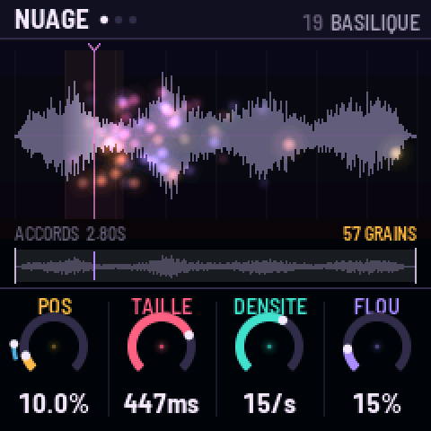
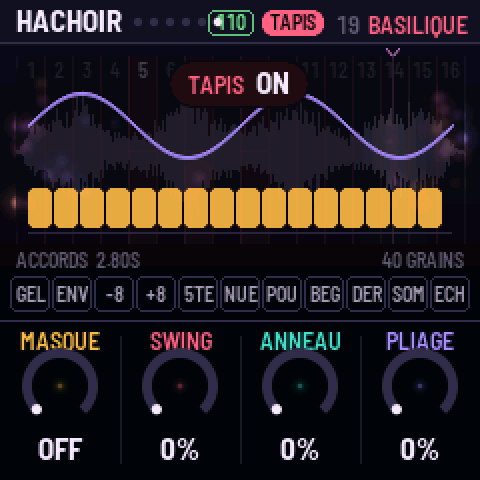
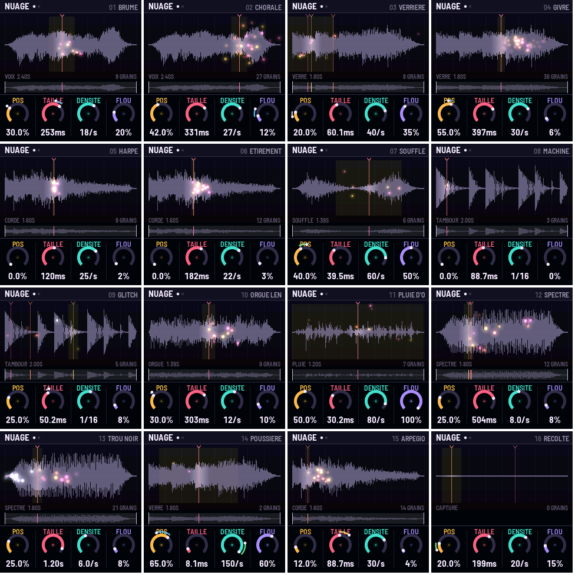
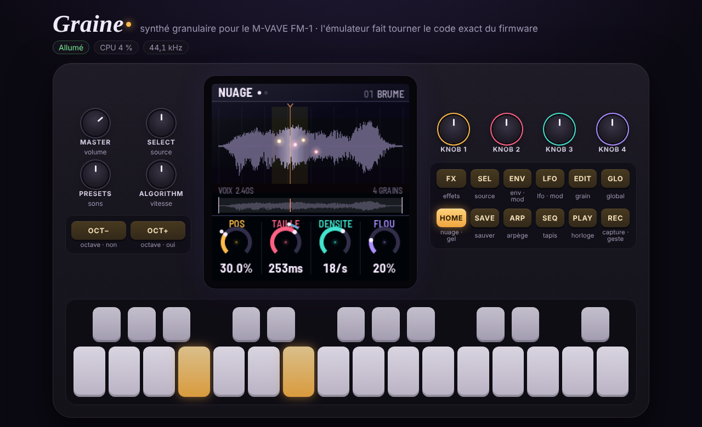

# GRAINE

Un synthé granulaire à base d'échantillons pour le **M-VAVE FM-1**. Firmware libre (MIT), bâti sur
[fm1-base](https://github.com/charlesvestal/fm1-base) (MPL-2.0).

**Le site : [omnipotard.github.io/Granular-FM1](https://omnipotard.github.io/Granular-FM1/)** : installer GRAINE,
importer tes sons, le manuel complet, l'émulateur, le firmware à télécharger.



Treize sources synthétisées (dont cinq qui évoluent : arpège, basse, accords, nappe, séquence), ta capture et
quatre emplacements pour tes sons, lus par jusqu'à **128 grains** sur **6 voix**, calculés par les **deux cœurs**
du FM-1. Vingt-quatre pages de quatre knobs, chacune avec son dessin : des nappes qui planent (grains étirés,
chœur, shimmer, résonateurs accordés, espace infini, scènes A/B, pluie de notes) aux sons qui piquent (grains
fous, hachoir sur l'horloge, masques rythmiques, anneau, pliage). Le manuel complet : `app/docs/MANUAL.md`.

## Le principe : trois gestes

1. **Tourner** : quatre knobs, toujours les mêmes couleurs (ambre, rose, turquoise, lilas) sur toutes les pages.
2. **Maintenir une source, tourner une destination** : maintiens `LFO` ou `ENV` et tourne un knob, il est modulé.
   Maintiens `REC` et tourne un knob, ton geste est enregistré et tourne en boucle.
3. **Jouer** : clavier en notes, ou en TAPIS (16 endroits du son + 11 pads de performance).

## Le panneau

| Commande | Tap | Maintien / combinaison |
|---|---|---|
| `HOME` | page NUAGE, puis JEU | maintenu : **GEL** (le balayage s'arrête) |
| `SEL` | SOURCE, puis BALAYAGE | |
| `EDIT` | GRAIN, puis TEXTURE | |
| `ENV` | AMPLI, puis ENV MOD | maintenu + knob : modulation par l'enveloppe (OCT−/+ : vélocité, pression, aléa, molette) |
| `LFO` | LFO 1, puis LFO 2 | maintenu + knob : modulation par le LFO (OCT−/+ : LFO 1 ↔ LFO 2) |
| `FX` | FILTRE, ÉCHO, ESPACE, MATIÈRE | |
| `GLO` | GLOBAL, HORLOGE, HASARD | |
| `ARP` | page ARPÈGE ; sur cette page : marche/arrêt | |
| `SEQ` | TAPIS on/off | maintenu : TAPIS le temps du maintien |
| `PLAY` | horloge (gestes, arpège, synchro) | |
| `REC` | **capture** de la sortie (devient la source CAPTURE) | maintenu + knob : **geste** ; `REC`+`OCT−` efface les gestes ; `REC`+`SAVE` garde la capture en flash (U1–U4) |
| `SAVE` | sauver le son (PRESETS choisit l'emplacement, `OCT+` oui, `OCT−` non) | |
| `OCT−` / `OCT+` | octave −3…+3 | les deux : octave 0 |
| `SELECT` | la source (les emplacements vides sont sautés) | |
| `PRESETS` | les 16 sons (un son modifié demande un second cran) | |
| `ALGORITHM` | vitesse de lecture, de ×−4 à ×4 ; **0 fige**, ×1 = temps réel (time-stretch) | |
| `KNOB 1–4` | les quatre paramètres de la page | |

## Les pages

| Bouton | Page | Knob 1 (ambre) | Knob 2 (rose) | Knob 3 (turquoise) | Knob 4 (lilas) |
|---|---|---|---|---|---|
| HOME | NUAGE | position | taille du grain (5 ms–2 s) | densité (0,5–150 grains/s, ou division) | flou de position |
| HOME | JEU | hauteur ±24 | essaim (écart de hauteur) | grains à l'envers | écart stéréo |
| SEL | SOURCE | source | début de fenêtre | longueur de fenêtre | accord fin |
| SEL | BALAYAGE | mode (boucle, aller-retour, une fois, ivre, sauts) | vitesse | départ à chaque note (relance, libre, commun) | note → position |
| EDIT | GRAIN | forme (gauss → hann → tukey → rect) | pente (percussif ↔ inversé) | quantif. de l'essaim (libre, demi-ton, octave, quinte, majeur, mineur, gamme) | rythme (régulier, aléatoire, synchro) |
| EDIT | TEXTURE | scintillement | éclat (grains à l'octave) | glisse dans le grain ±24 | lissage de position |
| ENV | AMPLI | attaque | déclin | tenue | relâche |
| ENV | ENV MOD | attaque | déclin | tenue | relâche |
| LFO | LFO 1 / 2 | vitesse (Hz ou division) | forme (sinus… hasard, dérive) | sync | départ (libre / à la note) |
| FX | FILTRE | type (PB → bande → PH) | coupure | résonance | saturation |
| FX | ÉCHO | temps (1/128 à 1/4.) | réinjection (jusqu'à l'auto-oscillation) | teinte | dose |
| FX | ESPACE | taille | durée (jusqu'à infini) | amorti | dose |
| FX | MATIÈRE | bits | rabot (sous-échantillonnage) | largeur stéréo | volume du son |
| ARP | ARPÈGE | mode | pas | octaves | durée |
| GLO | GLOBAL | voix (1 = mono legato) | portamento | gamme | tonique |
| GLO | HORLOGE | tempo | sensibilité à la vélocité | capture (une fois / boucle) | longueur des gestes |
| GLO | HASARD | **lancer** (chaque cran mute le son ; à rebours : annule) | dose | cible (nuage, grain, son, tout) | langue FR/EN |

## Le TAPIS

`SEQ` transforme le clavier. Les **16 touches blanches** sont 16 endroits de la fenêtre : avec `ALGORITHM` à ×1
c'est un découpeur d'échantillon, à 0 c'est un nuage figé à cet endroit. Les **11 touches noires** sont des pads,
actifs tant qu'on les tient :

gel · envers · −1 octave · +1 octave · quinte · nuée (densité ×4) · poussière (grains ÷4) · bégaie
(répétition à la double-croche) · dérive (flou et stéréo au maximum) · sombre (filtre fermé) · écho (envoi dub).



## Les sons

Huit sources, toutes **synthétisées** par `tools/gen_sounds.py` (aucun échantillon enregistré, aucun droit tiers) :
VOIX (chœur qui glisse de voyelle en voyelle), VERRE, CORDE, SOUFFLE, TAMBOUR, ORGUE, PLUIE, SPECTRE.
Plus CAPTURE (en RAM, 2,97 s) et U1–U4 (en flash, ce que tu gardes). Seize sons d'usine : BRUME, CHORALE,
VERRIÈRE, GIVRE, HARPE, ÉTIREMENT, SOUFFLE, MACHINE, GLITCH, ORGANUM, AVERSE, SPECTRE, TROU NOIR, POUSSIÈRE,
ARPEGIO, RÉCOLTE.



## MIDI

Notes (vélocité), pitch bend ±2, molette (CC1, source de modulation), pression (canal et polyphonique), sustain
(CC64), horloge et start/stop. CC 14–21 : les knobs de NUAGE et JEU ; CC 74 coupure, 71 résonance, 91 espace, 94 écho.

## L'émulateur

Le même code, compilé en WebAssembly, dans le navigateur : `./build.sh --web` produit `app/build/emu/site/`
(à héberger) et `app/build/emu/graine-emulateur.html` (un seul fichier à ouvrir). On peut y déposer un fichier
audio dans U1–U4 et brancher un clavier MIDI.



## Compiler

```sh
git submodule update --init --recursive
./build.sh --host            # le simulateur : n'importe quel compilateur C
sh tests/run_tests.sh        # les tests : simulateur, outil d'import, page d'import
./build.sh --web             # l'émulateur (Emscripten, ou clang + tools/emcc-wasi)
sh base/tools/get_toolchain.sh                    # la toolchain JieLi (Linux ou WSL)
git clone --depth 1 --branch AC79NN_SDK_V1.2.1_2023-12-13 https://gitee.com/Jieli-Tech/fw-AC79_AIoT_SDK.git ~/fw-AC79_AIoT_SDK
JIELI_TOOLCHAIN=~/.jieli/toolchain AC79_SDK=~/fw-AC79_AIoT_SDK ./build.sh   # le paquet FM-1 (app/build/graine.fwsc)
python3 tools/site.py 0.2 --publish               # la release, le site, poussés sur gh-pages
```

Un tag `vX.Y` poussé sur GitHub lance aussi `.github/workflows/release.yml` : le builder partagé de la
communauté FM-1 compile, teste et signe le paquet, et publie la release.

## Importer des sons sans navigateur

```sh
pip install mido python-rtmidi
python3 tools/graine_import.py mon-son.wav --slot 1
```

## Licence

GRAINE : MIT (`LICENSE`). fm1-base et felucca-bsp gardent leurs licences (MPL-2.0), dans `base/`.
Merci à Leo Kuroshita (Felucca, Hügelton Instruments) et à Charles Vestal (fm1-base).
