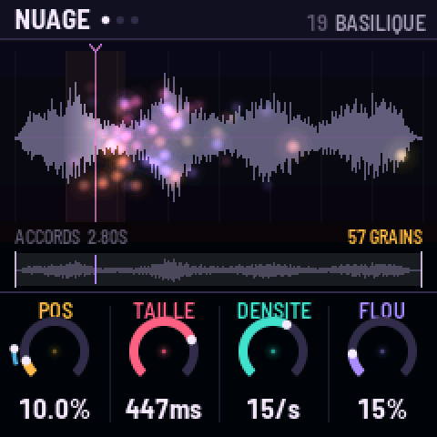
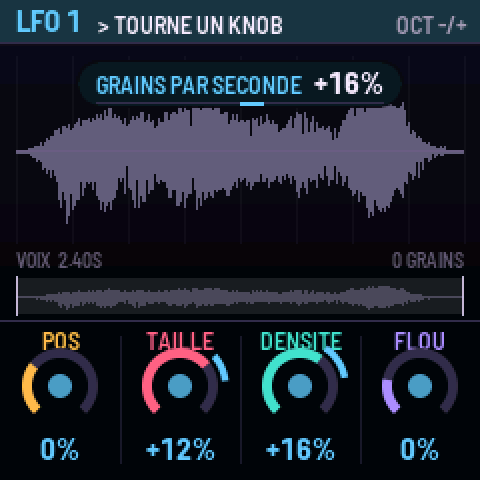
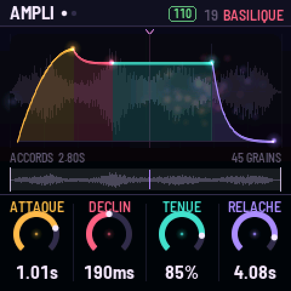
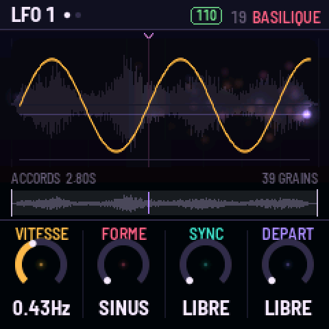
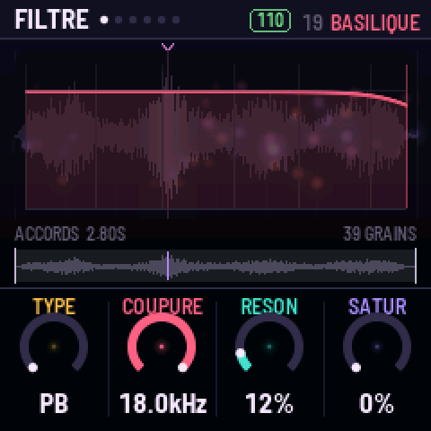
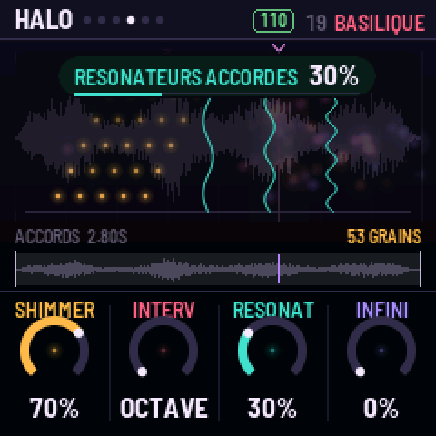
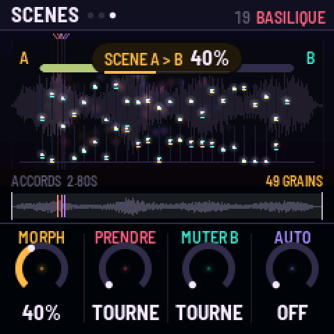
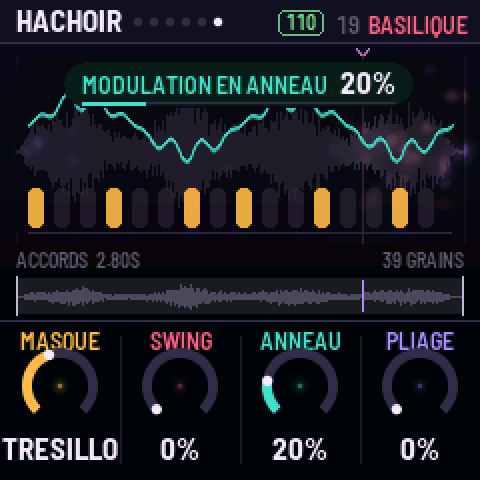
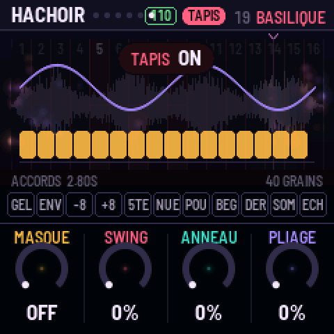
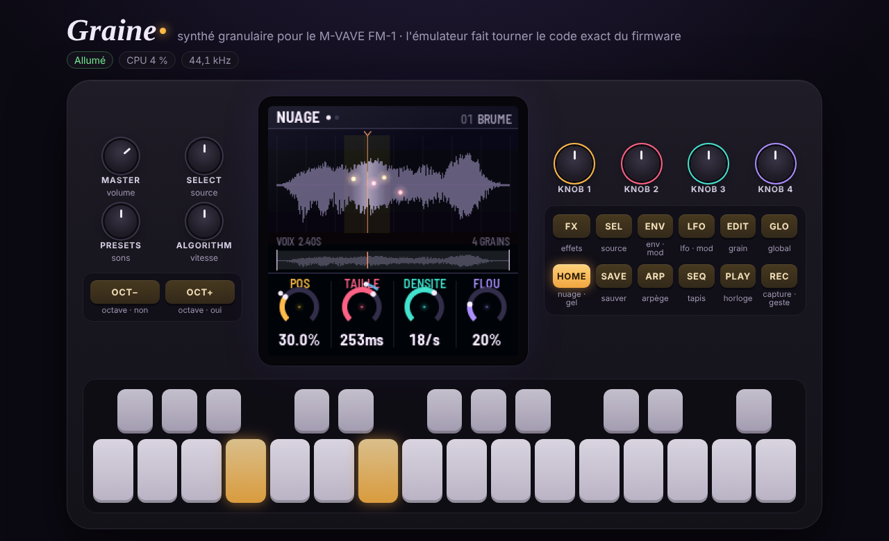

# GRAINE : le manuel

GRAINE transforme le **M-VAVE FM-1** en synthé granulaire. Treize sources (huit sons, cinq qui évoluent),
ta propre capture et quatre emplacements pour tes sons sont lus par jusqu'à **128 grains** répartis sur
**6 voix**, calculés par les **deux cœurs** du FM-1. L'écran montre ce que tu entends : chaque grain est une
graine lumineuse posée là où il lit le son.



## Installer

1. Ouvre la page **Installer** du site dans Chrome ou Edge (elle passe par le Web MIDI).
2. Branche le FM-1 avec un câble USB de données et suis la page : elle écrit GRAINE à la place du firmware
   d'origine. Pour revenir au firmware de M-VAVE, utilise leur outil de mise à jour.
3. GRAINE démarre sur le son BRUME. Joue les touches.

Sans navigateur : `python3 base/tools/fm1_install.py graine-X.Y.fwsc` depuis le dépôt de GRAINE.

## Le principe : trois gestes

1. **Tourner** : quatre knobs, toujours les mêmes couleurs (ambre, rose, turquoise, lilas) sur toutes les pages.
   Le dessin au-dessus du nuage montre ce qu'ils font, dans leurs couleurs.
2. **Maintenir une source, tourner une destination** : maintiens `LFO` ou `ENV` et tourne un knob, il est
   modulé. Maintiens `REC` et tourne un knob, ton geste est enregistré et tourne en boucle sur l'horloge.
3. **Jouer** : le clavier en notes, ou en TAPIS (16 endroits du son et 11 pads de performance).



## Le panneau

| Commande | Tap | Maintien / combinaison |
|---|---|---|
| `HOME` | NUAGE, JEU, SCÈNES | maintenu : **GEL** (le balayage s'arrête) |
| `SEL` | SOURCE, BALAYAGE | |
| `EDIT` | GRAIN, TEXTURE, DRONE, CHAOS | |
| `ENV` | AMPLI, ENV MOD | maintenu + knob : modulation par l'enveloppe (`OCT−/+` : vélocité, pression, aléa, molette) |
| `LFO` | LFO 1, LFO 2 | maintenu + knob : modulation par le LFO (`OCT−/+` : LFO 1 ↔ LFO 2) |
| `FX` | FILTRE, ÉCHO, ESPACE, HALO, MATIÈRE, HACHOIR | |
| `ARP` | ARPÈGE, PLUIE | |
| `GLO` | GLOBAL, HORLOGE, HASARD | |
| `SEQ` | TAPIS on/off | maintenu : TAPIS le temps du maintien |
| `PLAY` | l'horloge (gestes, arpège, hachoir, masque) | |
| `REC` | **capture** de la sortie (devient la source CAPTURE) | maintenu + knob : **geste** ; `REC`+`OCT−` efface les gestes ; `REC`+`SAVE` garde la capture (U1–U4) |
| `SAVE` | sauver le son (`PRESETS` choisit l'emplacement 1–24, `OCT+` oui, `OCT−` non) | |
| `OCT−` / `OCT+` | octave −3…+3 | les deux : octave 0 |
| `SELECT` | la source (les emplacements vides sont sautés) | |
| `PRESETS` | les 24 sons (un son modifié demande un second cran) | |
| `ALGORITHM` | vitesse de lecture, de ×−4 à ×4 ; **0 fige**, ×1 = temps réel | |
| `KNOB 1–4` | les quatre réglages de la page | |

## Les pages

Chaque page a ses quatre knobs, et son dessin en surimpression sur le nuage.

| Bouton | Page | Knob 1 (ambre) | Knob 2 (rose) | Knob 3 (turquoise) | Knob 4 (lilas) |
|---|---|---|---|---|---|
| HOME | NUAGE | position | taille du grain (5 ms–2 s) | densité (0,5–150 grains/s, ou division) | flou de position |
| HOME | JEU | hauteur ±24 | essaim (écart de hauteur) | grains à l'envers | écart stéréo |
| HOME | SCÈNES | **morph** A → B | **prendre B** (à rebours : échange A et B) | **muter B** (dose de HASARD) | morph **auto** (2 s à 1 min) |
| SEL | SOURCE | source | début de fenêtre | longueur de fenêtre | accord fin |
| SEL | BALAYAGE | mode (boucle, aller-retour, une fois, ivre, sauts) | vitesse | départ à chaque note | note → position |
| EDIT | GRAIN | forme (gauss → hann → tukey → rect) | pente | quantification de l'essaim | rythme (régulier, aléatoire, synchro) |
| EDIT | TEXTURE | scintillement | éclat (grains à l'octave) | glisse dans le grain ±24 | lissage de position |
| EDIT | DRONE | **étire** les grains (×1–×8, jusqu'à 16 s) | **chœur** (voix désaccordées et écartées) | **source B** | **mélange** A → B (grain par grain) |
| EDIT | CHAOS | **chaos** (grains fous) | **hache** (bégaie, roll, frein, envol, mélange) | pas (1/4–1/32) | chance |
| ENV | AMPLI | attaque | déclin | tenue | relâche |
| ENV | ENV MOD | attaque | déclin | tenue | relâche |
| LFO | LFO 1 / 2 | vitesse | forme (sinus… hasard, dérive) | sync (libre, tempo, **lent** ÷20) | départ (libre, à la note) |
| FX | FILTRE | type (PB → bande → PH) | coupure | résonance | saturation |
| FX | ÉCHO | temps (1/32 à 1/4.) | réinjection (jusqu'à l'auto-oscillation) | teinte | dose |
| FX | ESPACE | taille | durée (jusqu'à infini) | amorti | dose |
| FX | HALO | **shimmer** | intervalle (octave, quinte, octave+quinte, octave basse) | **résonateurs** accordés | **infini** (l'espace figé) |
| FX | MATIÈRE | bits | rabot (sous-échantillonnage) | largeur stéréo | volume du son |
| FX | HACHOIR | **masque** rythmique (7 motifs de 16 pas) | swing | **anneau** | **pliage** |
| ARP | ARPÈGE | mode | pas | octaves | durée |
| ARP | PLUIE | **pluie** (notes qui tombent seules) | étendue (octaves) | durée des gouttes | **tenue** (touches qui restent) |
| GLO | GLOBAL | voix (1 = mono legato) | portamento | gamme | tonique |
| GLO | HORLOGE | tempo | vélocité | capture (une fois, boucle, **seuil**) | longueur des gestes |
| GLO | HASARD | **lancer** (chaque cran mute le son ; à rebours : annule) | dose | cible | langue FR/EN |

### Les dessins

| | |
|---|---|
|  |  |
|  |  |

### Pour planer : DRONE, HALO, SCÈNES, PLUIE

- **ÉTIRE** allonge chaque grain jusqu'à 8 fois (16 s au plus) : les grains se chevauchent en une nappe
  continue. Avec la vitesse de lecture (`ALGORITHM`) proche de 0, le son se fige en un accord qui respire.
- **CHŒUR** désaccorde chaque voix un peu et la place ailleurs dans la stéréo.
- **SOURCE B** et **MÉLANGE** : une part des grains lit une deuxième source, au même endroit. Module MÉLANGE par
  un LFO lent et le son passe d'une matière à l'autre.
- **SHIMMER** renvoie l'espace transposé (une octave, une quinte, les deux, ou une octave plus bas) dans l'espace
  lui-même : le son monte sans fin. **INFINI** fige l'espace : ce qu'il contient tient, tu joues par-dessus.
- **RÉSONATEURS** : trois cordes accordées sur la note jouée, sa quinte et la tierce de la gamme (GLOBAL) font
  chanter n'importe quelle source dans la tonalité.
- **SCÈNES** : règle un son, tourne **PRENDRE** (il devient la scène B), change les knobs (c'est la scène A),
  puis **MORPH** passe de l'une à l'autre, tous les réglages à la fois. **AUTO** le fait tout seul, très
  lentement si tu veux. **MUTER** fabrique une scène B au hasard autour de la tienne.
- **PLUIE** fait tomber des notes de la gamme toutes seules : un générateur d'ambiance sans les mains.
  **TENUE** garde les touches enfoncées : un accord tenu, puis un second appui le relâche.
- **LFO lent** (SYNC = LENT) : des cycles de plusieurs minutes.



### Pour piquer : CHAOS, HACHOIR

- **CHAOS** : de temps en temps, un grain n'en fait qu'à sa tête : à l'envers, une octave plus haut ou plus
  bas, réduit à un clic, ailleurs dans le son, glissant de deux octaves, ou absent.
- **HACHE** : à chaque pas de l'horloge (`PAS`), selon la **CHANCE**, le son bégaie, roule (des répétitions
  de plus en plus serrées), freine comme une bande qui s'arrête ou s'envole d'une octave. MÉLANGE tire au sort.
  `PLAY` lance l'horloge interne ; sans elle, une horloge libre tourne quand même.
- **MASQUE** : sept rythmes de 16 pas (croches, syncope, tresillo, galop, haché, pulsation, aléatoire) ouvrent
  et ferment le son, avec du **SWING**. L'écho et l'espace continuent derrière.
- **ANNEAU** module le son par une sinusoïde un peu à côté de la note : du métal. **PLIAGE** replie l'onde.



## Le TAPIS

`SEQ` transforme le clavier. Les **16 touches blanches** sont 16 endroits de la fenêtre : avec `ALGORITHM` à ×1
c'est un découpeur d'échantillon, à 0 un nuage figé à cet endroit. Les **11 touches noires** sont des pads,
actifs tant qu'on les tient : gel · envers · −1 octave · +1 octave · quinte · nuée (densité ×4) · poussière
(grains ÷4) · bégaie · dérive · sombre · écho.



## Les sources

Toutes **synthétisées** par `tools/gen_sounds.py` : aucun échantillon enregistré, aucun droit tiers.

| | |
|---|---|
| VOIX | un chœur qui glisse de voyelle en voyelle |
| VERRE, CORDE, SOUFFLE, TAMBOUR, ORGUE, PLUIE, SPECTRE | verre frotté, cordes pincées, souffle, peaux, orgue, gouttes, drone FM |
| **ARPÈGE** | un arpège qui traverse La m – Fa – Do – Sol, son filtre qui s'ouvre |
| **BASSE** | une ligne de basse qui change et grogne de plus en plus |
| **ACCORDS** | Ré m9 – Si♭ maj7 – Fa maj7 – Do 6sus qui se fondent l'un dans l'autre |
| **NAPPE** | les harmoniques de La 1 qui entrent une à une |
| **SEQUENCE** | seize pas jamais pareils : bips FM, bruit, toms, glitch |
| CAPTURE | ce que tu as capturé avec `REC` (en mémoire vive, 2,97 s) |
| U1–U4 | tes sons : captures gardées, ou sons importés (ci-dessous) |

Les cinq sources qui évoluent sont faites pour être parcourues lentement : `ALGORITHM` vers ×0,1, et l'arpège,
la basse ou les accords avancent sur des dizaines de secondes.

## Les sons d'usine

BRUME, CHORALE, VERRIÈRE, GIVRE, HARPE, ÉTIREMENT, SOUFFLE, MACHINE, GLITCH, ORGANUM, AVERSE, SPECTRE,
TROU NOIR, POUSSIÈRE, ARPEGIO, RÉCOLTE, et sur les nouvelles sources et pages : **MONTÉE** (l'arpège qui monte
dans le shimmer), **GRAVE** (la basse, filtre à l'enveloppe), **BASILIQUE** (les accords étirés en chœur dans
un grand espace), **AUBE** (la nappe et ses résonateurs), **ROUAGES** (la séquence masquée et hachée),
**MIRAGE** (accords et nappe mêlés par un LFO), **ORAGE** (chaos, pliage, hachoir) et **SABLIER** (l'arpège
figé sous une pluie de notes). `SAVE` garde les tiens par-dessus, dans 24 emplacements.

## Tes propres sons

Quatre emplacements, **U1 à U4**, gardent tes sons dans la mémoire du FM-1, même éteint. Trois façons de les
remplir :

1. **Capturer** : `REC` enregistre ce que joue le FM-1 (CAPTURE), `REC`+`SAVE` le garde dans U1–U4.
   Avec la capture au **SEUIL** (HORLOGE), l'enregistrement attend le premier son.
2. **La page Importer** du site (Chrome ou Edge) : dépose n'importe quel fichier audio (WAV, MP3, OGG, FLAC,
   M4A…), écoute ce qui sera envoyé, choisis l'emplacement, **Envoyer**. Le son part par le câble USB.
3. **Sans navigateur**, depuis un terminal, dans le dépôt de GRAINE :

   ```sh
   pip install mido python-rtmidi
   python3 tools/graine_import.py mon-son.wav --slot 1
   python3 tools/graine_import.py --clear --slot 2
   ```

Un emplacement garde 65 504 octets : 2,9 s en qualité 22 kHz, 4 s à 16 kHz, 5,9 s à 11 kHz, 8,1 s à 8 kHz.
En mode auto, la meilleure qualité qui tient est choisie. Le silence du début est coupé, le son normalisé.
Le son du FM-1 s'arrête quelques secondes pendant l'écriture. Un envoi interrompu laisse l'emplacement vide,
jamais un demi-son. Le son importé devient la source jouée.

## MIDI

Notes (vélocité), pitch bend ±2, molette (CC1, source de modulation), pression (canal et polyphonique), sustain
(CC64), horloge et start/stop. CC 14–21 : les knobs de NUAGE et JEU ; CC 74 coupure, 71 résonance, 91 espace,
94 écho.

## L'émulateur

Le même code, compilé en WebAssembly, joue dans le navigateur (page **Émulateur** du site) : tous les réglages,
un clavier MIDI, et tes sons déposés dans U1–U4.



## Sous le capot

- **Deux cœurs** : le second calcule la moitié des grains. S'il venait à défaillir, GRAINE continue sur un seul
  cœur avec 64 grains jusqu'à l'extinction, sans redémarrer.
- Si le calcul déborde, GRAINE retire des grains un instant, puis les rend peu à peu.
- Mémoire : les 13 sources (385 Ko) et le programme tiennent dans les 581 Ko du FM-1 ; la capture (128 Ko),
  l'écho, l'espace, le shimmer et les résonateurs dans sa mémoire vive.
- Code libre (MIT), bâti sur fm1-base (MPL-2.0) et felucca-bsp (Felucca, Leo Kuroshita, Hügelton Instruments).
