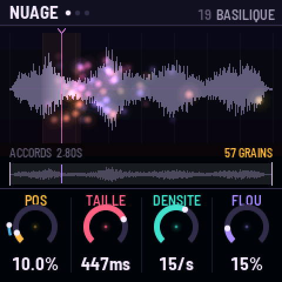
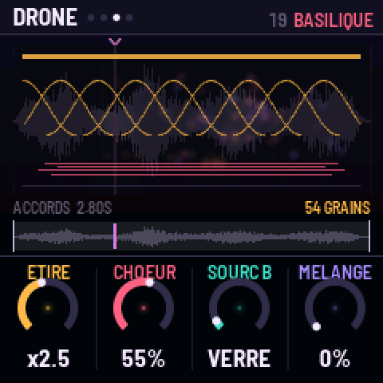
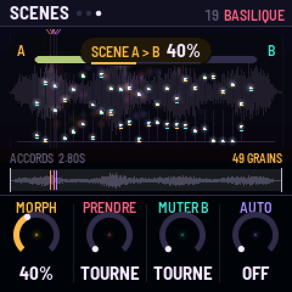
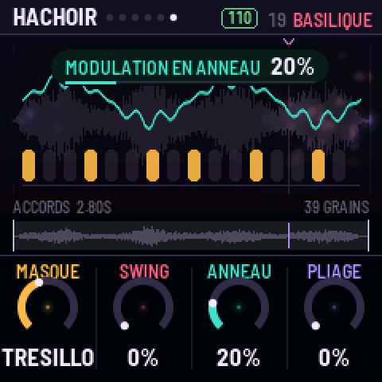

# GRAINE

**Un synthé granulaire pour le M-VAVE FM-1.** Version {{VERSION}}, libre (MIT).

Treize sources et tes propres sons, lus par jusqu'à **128 grains** sur **6 voix**, calculés par les deux cœurs
du FM-1. Des nappes qui planent (grains étirés, chœur, shimmer, résonateurs accordés, espace infini, scènes qui se
fondent l'une dans l'autre, pluie de notes) aux sons qui piquent (grains fous, hachoir sur l'horloge, masques
rythmiques, anneau, pliage). L'écran montre chaque grain là où il lit le son, et le dessin de chaque réglage.

- **[Installer GRAINE](install/)** sur ton FM-1 : Chrome ou Edge, un câble USB, une minute.
- **[Importer tes sons](importer/)** dans les emplacements U1 à U4 : WAV, MP3, OGG, FLAC…
- **[Le manuel](manual/)** : chaque bouton, chaque page.
- **[L'essayer dans le navigateur](emu/)** : le même code, sans FM-1.
- **[Télécharger le firmware](firmware/{{PKG}})** pour l'installer autrement (`fm1_install.py`).

| | |
|---|---|
|  |  |

Le code est sur [GitHub](https://github.com/Omnipotard/Granular-FM1). GRAINE est bâti sur
[fm1-base](https://github.com/charlesvestal/fm1-base) (MPL-2.0) et felucca-bsp, de Felucca par Leo Kuroshita
(Hügelton Instruments). Tous les sons intégrés sont synthétisés : aucun échantillon enregistré.
